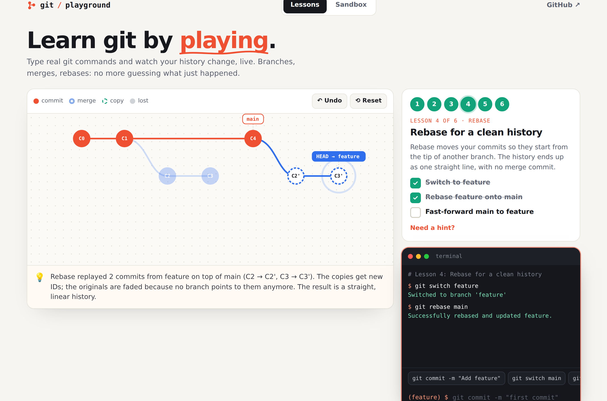
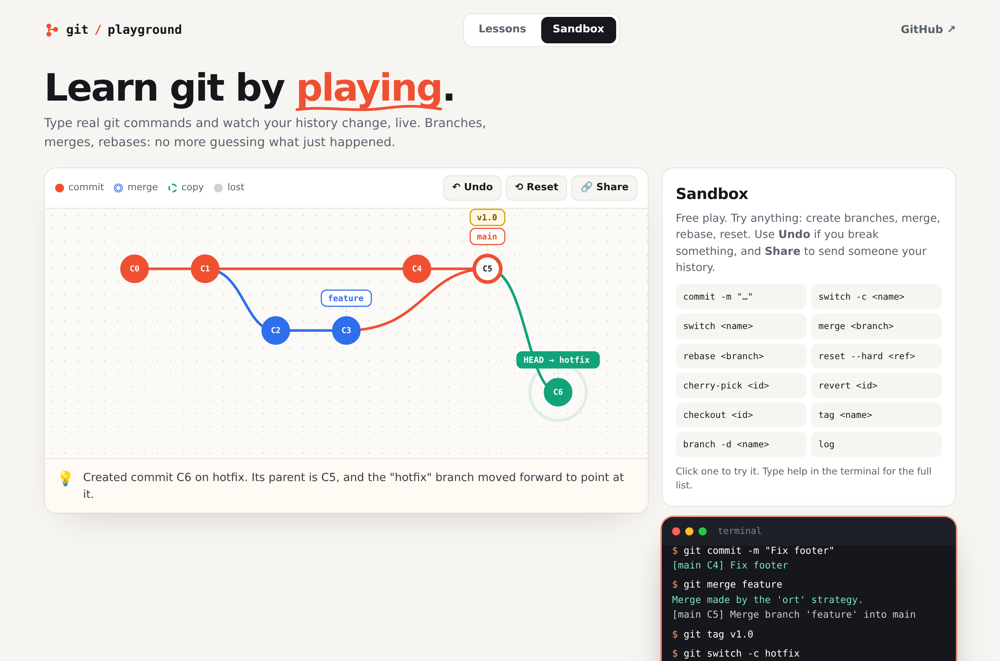
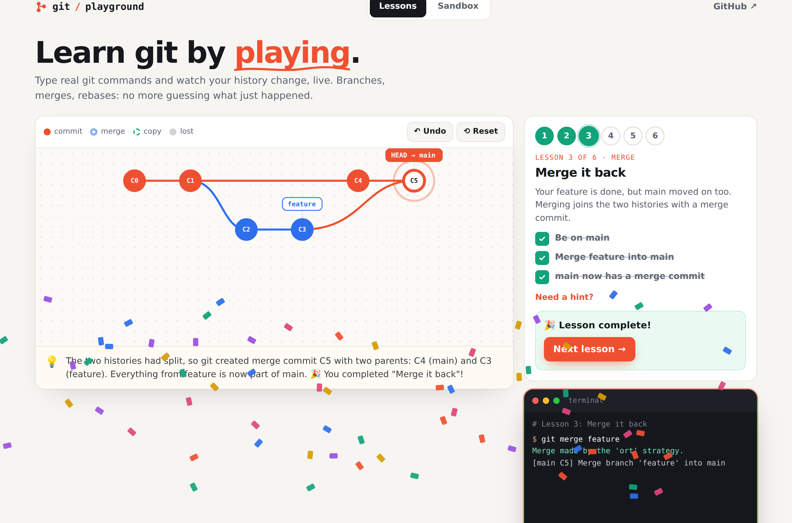

<div align="center">

# 🌳 Git Playground

**Learn git by playing.**

Type real git commands and watch your commit graph change live. Branches, merges, rebases: no more guessing what just happened.

[](https://mudit2308.github.io/git-playground/)
[](#how-it-works)
[](LICENSE)

**[👉 Start playing](https://mudit2308.github.io/git-playground/)**

</div>



## Features

- **A real git simulator**: `commit`, `branch`, `switch`, `checkout`, `merge` (fast-forward and merge commits), `rebase`, `reset`, `revert`, `cherry-pick`, `tag`, `log`, `status`, plus refs like `HEAD~2`, `main^` and tags
- **A live, animated commit graph**: new commits pop in, branch labels slide to where they move, and commits that are no longer on any branch fade out
- **"What just happened"**: a plain-English explanation after every command
- **6 guided lessons**: commits → branches → merge → rebase → undo → cherry-pick, with goals that tick off as you go, hints and answers
- **Sandbox mode**: free play with a clickable cheat sheet
- **Undo** (button, `undo` command or Ctrl+Z), command history with ↑/↓, and helpful errors ("Did you mean 'commit'?")
- **Share links**: send someone your exact history as a URL
- **Progress saved** in your browser, works on mobile

<p align="center">
  
  
</p>

## How it works

It's a static site with no backend and no dependencies.

- **`src/git.js`** is a small git engine. It models commits, branches, tags and HEAD (no files, just history). Every command is a pure function: `run(state, "git merge feature")` returns a new state, the terminal output and an explanation. That makes undo trivial (keep the previous states) and the engine easy to test.
- **`src/layout.js`** places commits left to right in creation order, with one row per branch.
- **`src/graph.js`** draws the graph as SVG and keeps elements keyed between renders, so labels animate to their new commit instead of jumping.
- **`src/levels.js`** defines the lessons: a setup history plus goals checked against the state after every command.

```
index.html        page structure
style.css         design and animations
src/git.js        the git simulator (pure functions)
src/layout.js     graph layout
src/graph.js      SVG rendering with animated updates
src/levels.js     guided lessons and their goals
src/app.js        terminal, lessons, sandbox, sharing
test/             unit tests (engine, layout, every lesson's solution)
```

The engine is covered by unit tests, including a check that every lesson starts incomplete and that its solution completes it.

## Run locally

```sh
npm start     # serves the folder at http://localhost:3000
npm test      # runs the unit tests (Node 18+)
```

## Deploy

GitHub Pages: **Settings → Pages → Deploy from a branch → `main` / root**.

## License

MIT
